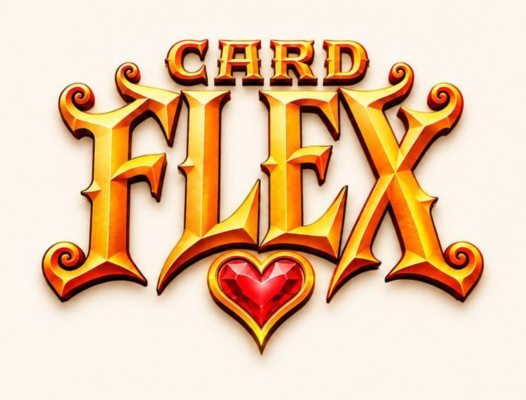
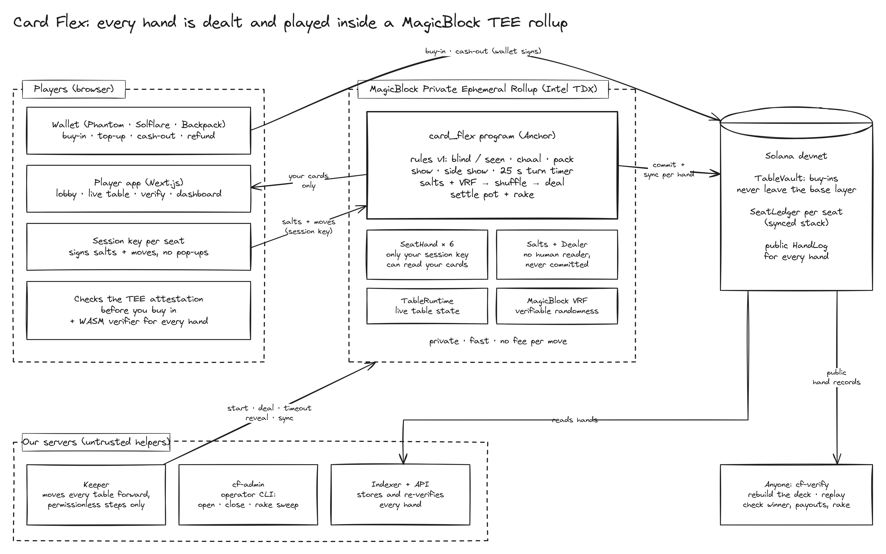

<div align="center">



## Private cards. Fair shuffle. Every hand provable.

A three-card game on Solana. Each hand is shuffled, dealt and played by a Solana program inside **MagicBlock's Private Ephemeral Rollup**, which runs in secure hardware (Intel TDX). Only you can read your cards, buy-ins never leave Solana, and anyone can check every finished hand.

**[Play on Devnet](https://cardflex.189-72-154-215.sslip.io)**

[X @cardflexfun](https://x.com/cardflexfun) · [Rules](https://cardflex.189-72-154-215.sslip.io/rules) · [Verify a hand](https://cardflex.189-72-154-215.sslip.io/verify) · Program [`4XUaBS…3vdL`](https://explorer.solana.com/address/4XUaBSuszDH8zUs3gMGgiBC7nckLnmhgubsXXvDL3vdL?cluster=devnet)

[](https://github.com/anindhabiswas25/cardflex/actions/workflows/ci.yml)
[](LICENSE)


</div>

<p align="center">
  

</p>

| Buy in | Play | Verify | Cash out |
|---|---|---|---|
| One wallet signature moves your buy-in into the table's vault on Solana. | Up to 6 players, 3 cards each. Moves are signed by a session key, so no wallet pop-ups. | After every hand, rebuild the deck and replay the betting in your browser. | Your synced stack goes back to your wallet. If the rollup stops, you can claim it back yourself. |

> **Devnet only.** Card Flex has not been audited and must not be used with
> real money. Play responsibly; 18+.

## What it is

Card Flex is a fast three-card game for up to six players: a boot from every player, blind or seen betting, chaal, pack, show and side show. It has three themed tables: **Amethyst Hall**, **Emerald Court** and **Ruby Throne**.

An online card game needs secrets: nobody, not even the house, may see the deck or another player's hand while it's played. A public blockchain can't keep secrets, so most on-chain card games deal on a private server and ask you to trust it. Card Flex runs the dealer itself on-chain, inside a MagicBlock Private Ephemeral Rollup (PER). The PER executes the `card_flex` program in a trusted execution environment, where account data can be private: your cards sit in an account that only your seat's session key can read.

The shuffle mixes a secret salt from every player with MagicBlock VRF randomness, and commits to the deck before the first card. When the hand ends, the program publishes everything needed to check it.

## Architecture



Money accounts (TableVault, SeatLedger) never leave Solana; secret accounts (SeatHand, salts, the dealer) never leave the PER ([ADR 0002](docs/adr/0002-account-lifecycle.md)). The keeper holds no table key: every step it takes (start a hand, deal, time out a slow player, reveal, sync) is a permissionless instruction anyone could send. Diagram source: [`docs/media/architecture-src/architecture.excalidraw`](docs/media/architecture-src/architecture.excalidraw) (open it at [excalidraw.com](https://excalidraw.com)).

## Try it in two minutes

1. **Open [the app](https://cardflex.189-72-154-215.sslip.io)** on a desktop or phone (phones play sideways).
2. **Connect a wallet** set to Devnet (Phantom, Solflare or Backpack), or pick the **Devnet test wallet** to play without an extension. Get devnet SOL from the wallet menu or [faucet.solana.com](https://faucet.solana.com).
3. **Take a seat** at a table and buy in (40–200 boots). A hand starts when 2 or more players are seated.
4. **Verify.** After the hand, open it from your dashboard or at `/verify`: the page rebuilds the deck from the published salts and VRF output, replays the betting and checks the winner, payouts and rake, all in your browser.

## How a hand works

1. **Buy in on Solana.** Your wallet signs one transaction that moves your
   buy-in into the table's vault and registers a fresh **session key** for
   this seat. The vault is never delegated: money stays on the base layer.
2. **Sit down in the private rollup.** The table's live state runs in the
   PER. Your session key is the only reader of your cards, and it signs your
   moves.
3. **Shuffle together.** Every dealt player's browser commits a secret
   salt. The program mixes the salts with a **verifiable random value
   (MagicBlock VRF)**, shuffles inside the TEE and deals each hand into a
   private account only that player's session key can read.
4. **Play.** Blind or seen, chaal, pack, show and side show are enforced by
   the program (rules v1). A 25-second turn timer means nobody can stall a
   table: anyone may time out a slow player.
5. **Reveal and settle.** When the hand ends the program publishes the
   salts, randomness and action log. Pot and rake are settled, and stacks are
   synced back to your seat ledger on Solana.
6. **Verify.** Anyone can rebuild the deck from the public record, replay
   the betting and check the winner, payouts and rake, in the browser
   (WebAssembly) or with the `cf-verify` CLI.
7. **Cash out.** Leave the table, and once your final stack is synced your
   wallet pulls it out of the vault. If the rollup ever stops, every player
   can claim back their last synced stack after a timeout. No redeal, ever.

## Hand ranking

| Rank | Hand | Example |
|---|---|---|
| 1 | Trail (three of a kind) | A-A-A is the best hand |
| 2 | Pure sequence (straight flush) | Q-J-10 of hearts |
| 3 | Sequence (straight) | 7-6-5, mixed suits |
| 4 | Color (flush) | three spades, not in a row |
| 5 | Pair | K-K-4 |
| 6 | High card | anything else |

A-K-Q is the top sequence and A-2-3 the second; K-A-2 isn't a sequence. Full rules: [the rules v1 spec](docs/spec/teen-patti-rules-v1.md).

## Why it needs MagicBlock

| In the game | MagicBlock piece |
|---|---|
| Your cards, the salts and the dealer stay hidden while the hand is played | **Private Ephemeral Rollup** (Intel TDX): per-account read permissions; the app checks the TEE's attestation before you buy in |
| Fast moves with no fee per action | **Ephemeral Rollup**: the table's runtime is delegated to MagicBlock's validator |
| A shuffle no single party controls | **VRF**, requested and answered inside the rollup, mixed with every player's salt |
| Playing without wallet prompts | **Session keys**, one per seat, registered at buy-in |
| Results and stacks reach Solana after every hand | **Commit and undelegate**: `commit_hand` + `sync_hand` copy the settled stacks to each seat's ledger |

## What you trust, and what you can check

Card Flex is **not trustless**, and we don't claim it is.

| You trust | For | Why it matters |
| --- | --- | --- |
| Intel TDX and MagicBlock's PER operator | **Privacy** of unrevealed cards and salts | The TEE keeps hands secret during play. The app checks the TEE's attestation (pinned measurements, TCB up to date) before you buy in. |
| Solana | **Custody** of buy-ins and stacks | Funds sit in a program-owned vault on the base layer, never in the rollup. |
| MagicBlock VRF | Part of the shuffle's randomness | Combined with every player's salt, so no single party picks the deck. |

| You can check yourself | How |
| --- | --- |
| The shuffle was fair and fixed before the deal | Salt commitments + VRF output + Merkle root over the deck, published per hand (CF-Fairness v2) |
| The rules were applied correctly | Replay the public action log with the rules engine |
| Winner, payouts and rake are right | The verifier recomputes the settlement from the replay |
| Your money can't be trapped | Permissionless timeouts at every phase; `emergency_refund` + `claim_refund` if the rollup stalls |

## On-chain addresses (devnet)

| What | Address |
|---|---|
| `card_flex` program | [`4XUaBSuszDH8zUs3gMGgiBC7nckLnmhgubsXXvDL3vdL`](https://explorer.solana.com/address/4XUaBSuszDH8zUs3gMGgiBC7nckLnmhgubsXXvDL3vdL?cluster=devnet) |
| Amethyst Hall (entry) | [`CeyYCmBPbtgToBC5onzY3tk71gqUewg92vzxAAsmBKfg`](https://explorer.solana.com/address/CeyYCmBPbtgToBC5onzY3tk71gqUewg92vzxAAsmBKfg?cluster=devnet) |
| Emerald Court (premium) | [`CH6CvNWrJGKLfgFF7SLoA7gjjuTCaedNUnut2XxCoSbT`](https://explorer.solana.com/address/CH6CvNWrJGKLfgFF7SLoA7gjjuTCaedNUnut2XxCoSbT?cluster=devnet) |
| Ruby Throne (high roller) | [`4fzQ3EN2Cy5sDjALB6X7jBV5yM157PVqv4XrfvJ7f4D9`](https://explorer.solana.com/address/4fzQ3EN2Cy5sDjALB6X7jBV5yM157PVqv4XrfvJ7f4D9?cluster=devnet) |
| MagicBlock PER (TEE) validator | [`MTEWGuqxUpYZGFJQcp8tLN7x5v9BSeoFHYWQQ3n3xzo`](https://explorer.solana.com/address/MTEWGuqxUpYZGFJQcp8tLN7x5v9BSeoFHYWQQ3n3xzo?cluster=devnet) |
| MagicBlock PER (TEE) RPC | `https://devnet-tee.magicblock.app` |

Table addresses are each table's `TableConfig` on Solana; the live game state is in the PER and private to the players seated there. The program only accepts tables delegated to the TEE validator above.

## Features

- **Rules v1**, frozen by test vectors and an independent Python
  implementation: blind/seen play, chaal (×1/×2), pack, show, side show,
  128-boot chaal limit, 1,024-boot pot limit, 25 s turns, rake with a cap.
- **Private cards** via per-seat permissions in the PER; Side Show grants a
  view of exactly two hands to exactly two players for that hand.
- **No pop-ups while playing**: one wallet signature to buy in, then a
  session key per seat.
- **Provable fairness**: CF-Fairness v2 commitments, a Rust verifier
  (`no_std` core, CLI and WebAssembly), every indexed hand re-verified.
- **Liveness and recovery**: permissionless timeouts for every phase,
  `abort_lost_hand` if secret state is lost, pull-based emergency refunds.
- **Operator tooling**: table creation and opening, keeper key, rake sweeps,
  vault reconciliation, alarms (`cf-admin watch`), TEE attestation monitoring,
  keeper health checks, runbooks.
- **Player app**: lobby, live table, verify page, dashboard with seats,
  cash-outs, refunds and history, sound and settings, desktop and mobile.

## Quick start

### Prerequisites

Versions are pinned in [`toolchain.env`](toolchain.env); `pnpm check:toolchain`
verifies your machine.

| Tool | Version | Install |
| --- | --- | --- |
| Rust | 1.89.0 | `rustup` (picked up from `rust-toolchain.toml`) |
| Solana / Agave CLI | 3.1.10 | `sh -c "$(curl -sSfL https://release.anza.xyz/v3.1.10/install)"` |
| Anchor | 1.1.2 | `cargo +1.91.0 install --git https://github.com/solana-foundation/anchor avm --tag v1.1.2 --locked && avm install 1.1.2 && avm use 1.1.2` |
| Node | 24.21.0 | `nvm install` (reads `.nvmrc`) |
| pnpm | 11.17.0 | `corepack enable` |

> The Anchor CLI's own lockfile needs Rust ≥ 1.91 to build; the workspace and
> the program stay on 1.89 ([ADR 0001](docs/adr/0001-toolchain-pins.md)).

### Build and test

```bash
git clone https://github.com/anindhabiswas25/cardflex.git
cd cardflex
pnpm install --frozen-lockfile
pnpm verify          # toolchain, program build, lint, Rust + JS tests, G2 verifier gate
```

`pnpm verify` runs the same checks as CI.

## Run the game locally

The program is deployed on Devnet at
`4XUaBSuszDH8zUs3gMGgiBC7nckLnmhgubsXXvDL3vdL`. To play, run the keeper (it
drives the tables), optionally the history API, and the web app:

```bash
# 1. keeper — needs a funded keypair named on each table (see "Operating tables")
CARDFLEX_KEEPER_KEY=~/.config/cardflex/keeper.json \
CARDFLEX_TABLES=<config>,<config> CARDFLEX_DB=./cardflex.db HEALTH_PORT=9464 \
pnpm keeper

# 2. indexer + read-only API on :4000 (hand history; optional)
CARDFLEX_DB=./cardflex.db pnpm api

# 3. the app on http://localhost:3000
pnpm web
```

The lobby lists the tables in [`apps/web/lobby.json`](apps/web/lobby.json).
Connect Phantom, Solflare or Backpack (set to **Devnet**), or pick the
**Devnet test wallet** to play without an extension, then get devnet SOL from
the wallet menu or [faucet.solana.com](https://faucet.solana.com).
More in [`apps/web/README.md`](apps/web/README.md).

## Operating tables

`cf-admin` is the operator CLI. It signs locally with your keypair (default
`~/.config/cardflex/devnet-deployer.json`); there is no key-holding server.

```bash
pnpm admin -- table create --boot 1000000 --rake-bps 250 --rake-cap 20000000
pnpm admin -- table keeper <config> <keeper pubkey>   # the keeper's own read key
pnpm admin -- table open <config>                     # funds a runtime reserve, delegates to the TEE, opens
pnpm admin -- table status <config>
pnpm admin -- table check <config> --strict           # reconcile the vault to the lamport
pnpm admin -- table sweep <config>                    # rake → treasury
pnpm admin -- watch --keeper-url http://host:9464/health --keeper <pubkey>   # alarms
pnpm admin -- tee                                     # current TEE attestation
pnpm admin -- table close <config>
```

Always open tables with `table open`: a live table's runtime can't be topped
up, and it needs a reserve to keep committing. Runbooks for deploys, the
keeper, alarms, incidents and the multisig handover are in
[`docs/runbooks/`](docs/runbooks/).

## Verifying a hand

- **In the browser:** open `/verify/<table>/<hand>` in the app, or paste a
  hand record at `/verify`. The page runs the same verifier as the CLI,
  compiled to WebAssembly.
- **From the command line:**

  ```bash
  cargo run -p fairness-verifier --bin cf-verify -- record.json
  ```

A hand record (`cf-hand-record/2`) contains everything needed: roster, salts,
VRF output, commitments, Merkle root, starting stacks, the action log and the
claimed result. The protocol is specified byte for byte in
[`docs/spec/cf-fairness-v2.md`](docs/spec/cf-fairness-v2.md).

## Testing

| Command | What it covers |
| --- | --- |
| `pnpm verify` | Everything CI runs: program build, fmt + clippy, Rust unit + LiteSVM program tests, fairness and rules vectors (independent Python), SDK/API/admin/keeper tests, web typecheck, the 10,000-hand verifier gate |
| `pnpm privacy-suite -- --region <label>` | 230 privacy checks against the real Devnet PER (G1) |
| `pnpm handflow -- --region <label>` | One full hand on Devnet: salts → VRF → deal → side show → timeout → reveal → verify |
| `pnpm game -- --region <label>` | Six-player multi-hand game on Devnet, every hand verified |
| `pnpm money -- --region <label>` | Join, leave, cash-out and rake, reconciled after every step |
| `pnpm recovery -- --region <label>` | PER outage drill: refunds and claims |
| `pnpm keeper-drill` · `pnpm multiuser` | The keeper running tables unattended; many separate users at once |
| `pnpm --filter @card-flex/web e2e:2p` (`e2e:3p`, `e2e:wallet`) | The web app in headless Chrome against Devnet |

Measured results from each drill are in [`docs/findings/`](docs/findings/).

## Repository layout

```text
programs/card-flex/         Anchor program: tables, seats, money, salts, VRF, deal, betting, recovery
crates/card-types/          Canonical card encoding (no_std)
crates/fairness-core/       CF-Fairness v2 (no_std)
crates/fairness-verifier/   Offline verifier library + cf-verify CLI
crates/fairness-wasm/       The verifier as WebAssembly
crates/teen-patti-core/     Rules v1: ranking and the betting state machine (no_std)
packages/client-sdk/        TypeScript client: PDAs, IDL-driven accounts and instructions,
                            PER login, TEE attestation, fairness, rules, verifier
packages/probes/            Devnet drills and probes
apps/web/                   The player app (Next.js)
services/keeper/            Keeper: drives every table with permissionless steps
services/api/               Indexer + read-only HTTP API
services/admin/             cf-admin operator CLI
docs/                       Status, ADRs, specs, findings, runbooks
scripts/                    Toolchain and deploy scripts
toolchain.env               Pinned versions (single source of truth)
```

## Documentation

| Document | What it is |
| --- | --- |
| [`docs/STATUS.md`](docs/STATUS.md) | What's done, in progress and next |
| [`docs/adr/`](docs/adr/) | Architecture decisions (toolchain, account lifecycle, fairness encoding, recovery, seats and money, indexer) |
| [`docs/spec/`](docs/spec/) | CF-Fairness v2 and the game rules v1, with test vectors |
| [`docs/findings/`](docs/findings/) | Measured results: latency, privacy, load, fees, recovery, web E2E |
| [`docs/runbooks/`](docs/runbooks/) | Deploy, keeper, alarms, incidents, multisig |

## Project status

Development is gate-driven, with no fixed release date.

| Phase | State |
| --- | --- |
| P0–P6: toolchain, private table, fairness, recovery, rules, game loop, money | ✅ done, verified on Devnet |
| G1 privacy · G2 verifier (10,000 hands) · G3 go/no-go on MagicBlock | ✅ passed |
| P7: SDK, indexer, admin, player app | ✅ done |
| P8: hardening (liveness, security review, ops, load, fees, monitoring) | ✅ done; multisig handover pending |
| P9: public Devnet release | 🚧 in progress: hosted Devnet build live; multi-machine load test next |

Mainnet is a separate decision after P9 and needs external audits.

## Security

- **Not audited. Devnet only.**
- Please report vulnerabilities privately to the maintainer
  ([@anindhabiswas25](https://github.com/anindhabiswas25)), not in a public
  issue.
- No secrets live in this repository: keypairs, `.env` files and test
  wallets are ignored by `.gitignore`, and program logs never contain card,
  salt or seed data (enforced by a test).

## Contributing

Pinned toolchain only
(changes need an ADR), one commit per ticket with the ticket id
(`CF-0xx: …`), `pnpm verify` must pass, and the frozen rules and fairness
bytes change only with a version bump.

## License

[Apache License 2.0](LICENSE). See [`NOTICE`](NOTICE). The license grants no
rights to the Card Flex name or logo.
